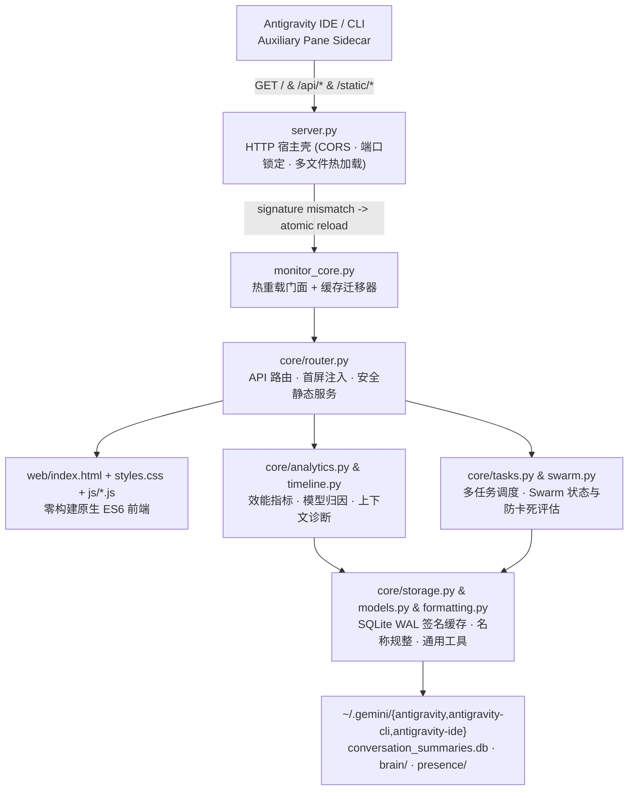

# Antigravity Pulse

**Antigravity Pulse** 是面向 **Google Antigravity IDE / CLI** 的轻量级、零外部依赖插件与可观测性监控 Sidecar。它在辅助侧边栏（Auxiliary Pane）原生运行，提供 **多任务与 Swarm 子代理实时拓扑追踪**、**多模型 Token/调用量统计**、**全局效能分析** 以及 **单会话上下文膨胀诊断**，并支持前后端代码热重载（`Cmd + R` 即可零重启生效，解析缓存零丢失）。

---

## 核心特性

1. **🤖 模型使用量统计（无感 4 级归因 + 双环 + 7 列可排序数据表）**
   - 自动按「步骤显式 `model` 字段 -> Swarm `members.json` 契约 -> `<USER_SETTINGS_CHANGE>` 设置变更事件（含首轮前向回填）-> 子代理父级继承」四级优先级精准归因模型。
   - 自动剥离思考/速度档位标签（如 High / XHigh / Thinking），按基础模型聚合对比 **Token 消耗**、**调用次数**、**均耗/次**、**缓存命中率**、**会话数** 与 **预估费用**，并支持点击模型行直接筛选下方对应会话。
2. **📊 全局效能大盘 & DSH 会话概览**
   - 支持 **今天 / 7天 / 30天 / 全部** 四档时间范围联动，覆盖 6 项核心 KPI、分时/按天/按周双轴趋势图、Token 构成环、耗时构成环与 168 天（24 周）活跃度热力图。
   - 会话卡片展示上下文占用率仪表环、工作区芯片过滤、模型徽标检索与跨月份快速定位，并统一修复 SQLite `0001-01-01` 零值时间戳回退。
3. **📈 单会话上下文演进与瘦身诊断抽屉**
   - 基于真实计费增量与历史文本字节估算（`_est_tokens`）绘制每轮上下文走势曲线，精准识别 `<CONTEXT_SUMMARY>` 压缩节点、突发膨胀（`> 25k` Tokens）、超大工具输出与重复全量读盘，一键生成 `/compact` 指令或 Markdown 诊断简报。
4. **🐝 实时多任务与 Swarm 并发监控（防卡死预警）**
   - 提供 **聚焦追踪**、**并发看板**、**对比矩阵** 三视图，支持 `swarm_wait` 状态识别、Swarm 消息板活跃时间融合以及 `WARNING` / `STUCK` 心跳超时告警。
5. **⚡ 原子热重载与纵深安全**
   - `server.py` 锁定 IDE 分配端口、PID 与 Auth Token；`monitor_core.py` 刷新 `core.*` 子模块并通过 `CACHE_SCHEMA_VERSION` 自动无缝迁移全部解析缓存。
   - 仅允许本地回环 Origin（`127.0.0.1` / `localhost`）CORS 访问；静态资源服务严格防御目录穿越（仅放行白名单扩展名）；前端所有动态 DOM/属性均经 `escHtml()` 编码且内联 JSON 经过 `</script>` 注入转义。

---

## 架构设计



---

## 目录结构

```text
antigravity-pulse/
├── plugin.json                        # Antigravity 插件清单
├── hooks.json                         # 会话启动 Hook 声明
├── hooks/on_session_start.py          # 自动注入监控快捷入口
├── rules/AGENTS.md                    # 智能体自动挂载 Sidecar 规范
├── skills/antigravity-pulse/SKILL.md  # 技能说明
├── scripts/
│   ├── install.sh                     # 安装新插件或同步 Sidecar 至已有插件
│   └── check.sh                       # 语法编译、JS 检查、单元测试与隐私扫描
├── tests/                             # 基于临时目录的纯离线单元测试
└── sidecars/task_monitor/
    ├── sidecar.json                   # Sidecar 启动与侧边栏视图配置
    ├── server.py                      # 常驻 HTTP 宿外壳
    ├── monitor_core.py                # 模块化热重载门面
    ├── core/                          # 分层后端包 (10 个职责单一模块)
    └── web/                           # 原生前端 (index.html + styles.css + 6 个 JS 模块)
```

---

## 快速安装

### 方式一：作为独立开源插件安装
```bash
git clone <your-git-repo-url>/antigravity-pulse.git
cd antigravity-pulse
./scripts/install.sh
```
安装完成后在 Antigravity Customizations 面板启用 **Antigravity Pulse**，对话中点击 `[⚡ Antigravity Pulse 监控盘](sidecar://antigravity-pulse/task_monitor/)` 即可打开。

### 方式二：热同步 Sidecar 至已有本地 `task-monitor` 插件
```bash
./scripts/install.sh --sync-sidecar task-monitor
```
在当前插件 Sidecar 已运行状态下执行后，仅需在侧边栏按 **`Cmd + R`** 即可热加载新架构且保留既有解析缓存。

---

## 本地校验与测试

项目无任何第三方依赖，运行期仅需 Python `3.9+`：

```bash
./scripts/check.sh
```

支持通过环境变量 `ANTIGRAVITY_DATA_DIRS` 指定自定义的 Antigravity 数据根目录列表（以系统路径分隔符 `:` 分隔），便于多实例分析或隔离测试：

```bash
ANTIGRAVITY_DATA_DIRS="/path/to/profile1:/path/to/profile2" python3 sidecars/task_monitor/server.py
```

---

## 开源协议

本项目基于 [MIT License](LICENSE) 开源。
