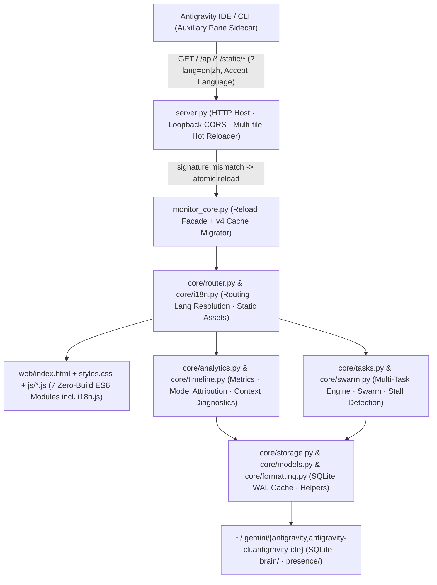

**English** | [简体中文](README.zh-CN.md)

# Antigravity Pulse

**Antigravity Pulse** is a lightweight, zero-dependency observability plugin and live telemetry sidecar for **Google Antigravity IDE / CLI**. Running natively inside the Auxiliary Pane, it delivers **bilingual UI and API support (English & Simplified Chinese)**, **real-time multi-task & Swarm subagent topology tracking**, **per-model Token/call analytics**, **global efficiency telemetry**, and **per-session context-growth diagnostics** — all with atomic hot-reloading (`Cmd + R`) and zero-loss parse caching.

---

## Core Features

1. **🌐 Bilingual UI & API (`EN / 中`, `?lang=en|zh`, `Accept-Language`)**
   - Instant **`EN / 中`** switcher in the top navigation bar toggles static labels, tooltips, KPIs, model usage tables, task monitors, context drawers, and Markdown diagnostic reports in place without page reload.
   - All HTTP routes (`/`, `/api/all`, `/api/analytics`, `/api/sessions`, `/api/multi_task`, `/api/session/context_timeline`, `/api/task_steps`) respect `?lang=en|zh` query parameters and fall back to the `Accept-Language` request header.
   - Transcript & SQLite parse caches (`CACHE_SCHEMA_VERSION = "v4"`) stay completely language-agnostic — switching languages takes **0 ms of re-parsing** and relies purely on volatile state (zero `localStorage` usage).
2. **🤖 Model Usage Telemetry (4-Tier Attribution + Dual Donuts + Sortable Table)**
   - Attributes every planner invocation via a 4-tier hierarchy: explicit step `model` field -> Swarm `members.json` roster -> `<USER_SETTINGS_CHANGE>` events (including first-turn forward backfill) -> parent subagent inheritance.
   - Strips thinking/speed modifiers (e.g., High / XHigh / Thinking) to aggregate **Token consumption**, **call counts**, **avg tokens/call**, **cache hit rate**, **sessions**, and **estimated cost**, with one-click session cross-filtering per model row.
3. **📊 Global Efficiency Dashboard & Session Overview**
   - Supports four global time windows (**Today / 7d / 30d / All**), covering 6 KPI cards, dynamic usage trend charts, token composition & time-breakdown donuts, and a 168-day (24-week) activity heatmap.
   - Session cards include context occupancy rings, workspace/month/model filtering, search, and unified handling for legacy SQLite `0001-01-01` zero timestamps.
4. **📈 Per-Session Context Evolution & Diagnostics Drawer**
   - Plots per-turn context growth using real billing deltas and byte-based real-text fallbacks (`_est_tokens`), detects `<CONTEXT_SUMMARY>` compaction drops, single-turn spikes (`> 25k` tokens), oversized tool outputs, and duplicate full-file reads, and copies ready-to-use `/compact` commands or Markdown diagnosis reports.
5. **🐝 Live Multi-Task & Swarm Concurrency Monitor (Stall Detection)**
   - Provides **Focus**, **Grid**, and **Matrix** views with `swarm_wait` detection, Swarm message-board activity merging, step-stream inspection, and `WARNING` / `STUCK` heartbeat alerts.
6. **⚡ Atomic Hot-Reload & Defense-in-Depth Security**
   - `server.py` locks the IDE-assigned port, PID, and auth token; `monitor_core.py` reloads `core.*` modules atomically with automatic `CACHE_SCHEMA_VERSION` cache migration.
   - Enforces loopback-only CORS (`127.0.0.1` / `localhost`), strict path-traversal rejection and allowlisted extensions in `/static/*`, `escHtml()` encoding on dynamic DOM fragments/attributes, and `</script>`-safe JSON hydration.

---

## Architecture



---

## Directory Structure

```text
antigravity-pulse/
├── README.md                          # English documentation (default)
├── README.zh-CN.md                    # Simplified Chinese documentation
├── CONTRIBUTING.md                    # Bilingual contributor guide
├── CHANGELOG.md                       # Release notes (v1.1.0)
├── plugin.json                        # Antigravity plugin manifest
├── hooks.json                         # Session start hook declaration
├── hooks/on_session_start.py          # Injects dashboard launch pill on session start
├── rules/AGENTS.md                    # Sidecar auto-surfacing rule
├── skills/antigravity-pulse/SKILL.md  # Skill definition
├── scripts/
│   ├── install.sh                     # Install plugin or hot-sync Sidecar to existing plugin
│   └── check.sh                       # Bytecode, JS syntax, unittest, and privacy scan
├── tests/                             # Offline unit tests (including tests/test_i18n.py)
└── sidecars/task_monitor/
    ├── sidecar.json                   # Sidecar entrypoint & auxiliary pane config
    ├── server.py                      # Resident HTTP host shell
    ├── monitor_core.py                # Modular reload facade & cache migrator
    ├── core/                          # Layered Python backend (11 single-responsibility modules, incl. i18n.py)
    └── web/                           # Zero-build frontend (index.html + styles.css + 7 JS modules, incl. i18n.js)
```

---

## Quick Install

### Option 1: One-Line Remote Install (No `git clone` Required)

**macOS / Linux:**
```bash
curl -fsSL https://raw.githubusercontent.com/lmjmt/antigravity-pulse/main/scripts/install.sh | bash
```

**Windows (PowerShell):**
```powershell
irm https://raw.githubusercontent.com/lmjmt/antigravity-pulse/main/scripts/install.ps1 | iex
```

> **Private repository note**: If the repository is private, export `GITHUB_TOKEN` (or `GITLAB_TOKEN` for self-hosted GitLab `--archive-url`) before running the one-liner. Pin a release tag via `--version v1.2.0` and optionally verify integrity with `--sha256 <hex>`.

### Option 2: Install / Update / Diagnose / Uninstall from a Local Clone
```bash
git clone https://github.com/lmjmt/antigravity-pulse.git
cd antigravity-pulse
./scripts/install.sh                 # Install (runs preflight doctor automatically)
./scripts/install.sh --doctor        # Check Python 3.9+, data dirs & plugin conflicts
./scripts/install.sh --update        # Update installation in place
./scripts/install.sh --uninstall     # Cleanly remove antigravity-pulse
```
Enable **Antigravity Pulse** in the Antigravity Customizations panel and open `[⚡ Antigravity Pulse](sidecar://antigravity-pulse/task_monitor/)` from any chat.

### Option 3: Hot-Sync Sidecar into an Existing `task-monitor` Plugin
```bash
./scripts/install.sh --sync-sidecar task-monitor
```
While the existing sidecar process keeps running, press **`Cmd + R`** in the Auxiliary Pane to hot-reload the updated backend and UI with zero cache loss.

---

## Local Verification & Testing

Zero third-party dependencies — requires only Python `3.9+` at runtime:

```bash
./scripts/check.sh
```

Override scanned Antigravity data roots via `ANTIGRAVITY_DATA_DIRS` (`:`-separated on POSIX):

```bash
ANTIGRAVITY_DATA_DIRS="/path/to/profile1:/path/to/profile2" python3 sidecars/task_monitor/server.py
```

---

## License

Released under the [MIT License](LICENSE).
