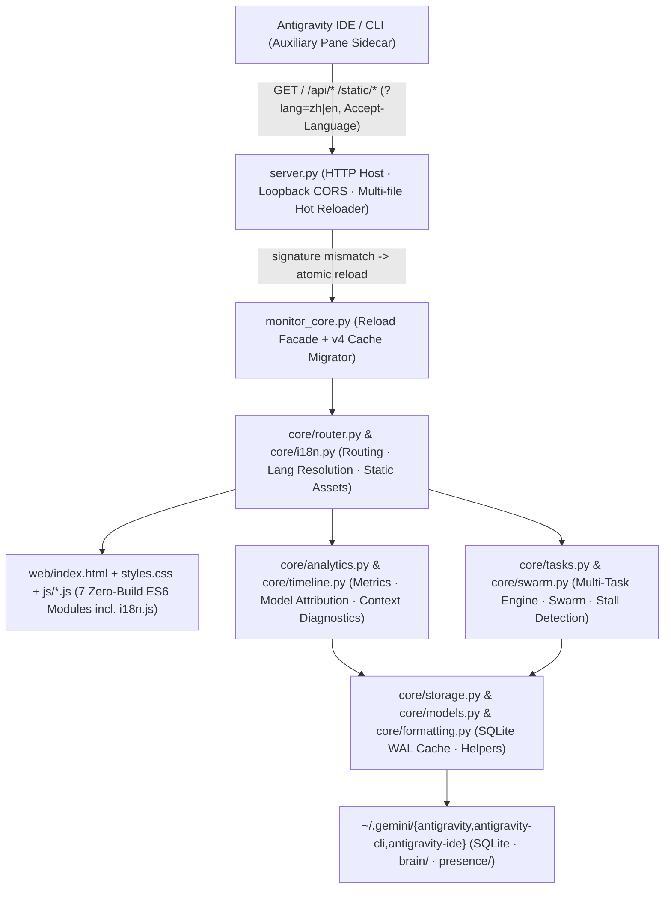

[English](README.md) | **简体中文**

# Antigravity Pulse

**Antigravity Pulse** 是面向 **Google Antigravity IDE / CLI** 的轻量级、零外部依赖插件与可观测性监控 Sidecar。它在辅助侧边栏（Auxiliary Pane）原生运行，提供 **中英双语界面与 API（ZH / EN）**、**多任务与 Swarm 子代理实时拓扑追踪**、**多模型 Token/调用量统计**、**全局效能分析** 以及 **单会话上下文膨胀诊断**，并支持前后端代码热重载（`Cmd + R` 即可零重启生效，解析缓存零丢失）。

---

## 核心特性

1. **🌐 中英双语支持（前端无感切换 + 服务端 API 本地化）**
   - 顶部导航栏内置 **`EN / 中`** 一键切换按钮，支持零刷新实时切换全站 UI 与图表提示。
   - 所有 `/api/*` 与首屏渲染均支持 `?lang=zh|en` 查询参数，并自动解析浏览器 `Accept-Language` 请求头。
   - 底层 JSONL / SQLite 解析缓存（`CACHE_SCHEMA_VERSION = "v4"`）保持与语言完全解耦，切换语言 **0ms 复用解析结果**，无需重扫日志，且不使用 `localStorage` 等持久化客户端存储。
2. **🤖 模型使用量统计（无感 4 级归因 + 双环 + 7 列可排序数据表）**
   - 自动按「步骤显式 `model` 字段 -> Swarm `members.json` 契约 -> `<USER_SETTINGS_CHANGE>` 设置变更事件（含首轮前向回填）-> 子代理父级继承」四级优先级精准归因模型。
   - 自动剥离思考/速度档位标签（如 High / XHigh / Thinking），按基础模型聚合对比 **Token 消耗**、**调用次数**、**均耗/次**、**缓存命中率**、**会话数** 与 **预估费用**，并支持点击模型行直接筛选下方对应会话。
3. **📊 全局效能大盘 & 会话概览**
   - 支持 **今天 / 7天 / 30天 / 全部** 四档时间范围联动，覆盖 6 项核心 KPI、分时/按天/按周双轴趋势图、Token 构成环、耗时构成环与 168 天（24 周）活跃度热力图。
   - 会话卡片展示上下文占用率仪表环、工作区芯片过滤、模型徽标检索与跨月份快速定位，并统一修复 SQLite `0001-01-01` 零值时间戳回退。
4. **📈 单会话上下文演进与瘦身诊断抽屉**
   - 基于真实计费增量与历史文本字节估算（`_est_tokens`）绘制每轮上下文走势曲线，精准识别 `<CONTEXT_SUMMARY>` 压缩节点、突发膨胀（`> 25k` Tokens）、超大工具输出与重复全量读盘，一键生成 `/compact` 指令或 Markdown 诊断简报。
5. **🐝 实时多任务与 Swarm 并发监控（防卡死预警）**
   - 提供 **聚焦追踪**、**并发看板**、**对比矩阵** 三视图，支持 `swarm_wait` 状态识别、Swarm 消息板活跃时间融合以及 `WARNING` / `STUCK` 心跳超时告警。
6. **⚡ 原子热重载与纵深安全**
   - `server.py` 锁定 IDE 分配端口、PID 与 Auth Token；`monitor_core.py` 刷新 `core.*` 子模块并通过 `CACHE_SCHEMA_VERSION` 自动无缝迁移全部解析缓存。
   - 仅允许本地回环 Origin（`127.0.0.1` / `localhost`）CORS 访问；静态资源服务严格防御目录穿越（仅放行白名单扩展名）；前端所有动态 DOM/属性均经 `escHtml()` 编码且内联 JSON 经过 `</script>` 注入转义。

---

## 架构设计



---

## 目录结构

```text
antigravity-pulse/
├── README.md                          # English documentation (default)
├── README.zh-CN.md                    # 简体中文文档
├── CONTRIBUTING.md                    # Bilingual contributor guide
├── CHANGELOG.md                       # Release notes (v1.1.0)
├── plugin.json                        # Antigravity plugin manifest
├── hooks.json                         # Session start hook declaration
├── hooks/on_session_start.py          # Injects dashboard launch pill on session start
├── rules/AGENTS.md                    # Sidecar auto-surfacing rule
├── skills/antigravity-pulse/SKILL.md  # Skill definition
├── scripts/
│   ├── install.sh                     # Install plugin or hot-sync Sidecar to existing plugin
│   └── check.sh                       # Bytecode, JS syntax, unittest, and privacy scan
├── tests/                             # Offline unit tests (including tests/test_i18n.py)
└── sidecars/task_monitor/
    ├── sidecar.json                   # Sidecar entrypoint & auxiliary pane config
    ├── server.py                      # Resident HTTP host shell
    ├── monitor_core.py                # Modular reload facade & cache migrator
    ├── core/                          # Layered Python backend (11 single-responsibility modules, incl. i18n.py)
    └── web/                           # Zero-build frontend (index.html + styles.css + 7 JS modules, incl. i18n.js)
```

---

## 快速安装

### 方式一：一行命令远程免克隆安装（推荐）

**macOS / Linux：**
```bash
curl -fsSL https://raw.githubusercontent.com/lmjmt/antigravity-pulse/main/scripts/install.sh | bash
```

**Windows (PowerShell)：**
```powershell
irm https://raw.githubusercontent.com/lmjmt/antigravity-pulse/main/scripts/install.ps1 | iex
```

> **私有仓库提示**：若仓库当前为 Private，执行前请先导出 `GITHUB_TOKEN`（自托管 GitLab 可配合 `--archive-url` 与 `GITLAB_TOKEN`）。支持通过 `--version v1.2.0` 锁定版本，或使用 `--sha256 <hex>` 校验归档完整性。

### 方式二：本地克隆安装、自检、升级与卸载
```bash
git clone https://github.com/lmjmt/antigravity-pulse.git
cd antigravity-pulse
./scripts/install.sh                 # 自动预检并安装至 ~/.gemini/config/plugins/antigravity-pulse
./scripts/install.sh --doctor        # 环境自检（Python 版本、数据目录、旧版冲突检测）
./scripts/install.sh --update        # 原地升级
./scripts/install.sh --uninstall     # 一键卸载
```
安装完成后在 Antigravity Customizations 面板启用 **Antigravity Pulse**，对话中点击 `[⚡ Antigravity Pulse 监控盘](sidecar://antigravity-pulse/task_monitor/)` 即可打开。

### 方式三：热同步 Sidecar 至已有本地 `task-monitor` 插件
```bash
./scripts/install.sh --sync-sidecar task-monitor
```
在当前插件 Sidecar 已运行状态下执行后，仅需在侧边栏按 **`Cmd + R`** 即可热加载新代码并保留既有解析缓存。

---

## 本地校验与测试

项目无任何第三方依赖，运行期仅需 Python `3.9+`：

```bash
./scripts/check.sh
```

支持通过环境变量 `ANTIGRAVITY_DATA_DIRS` 指定自定义的 Antigravity 数据根目录列表（以系统路径分隔符 `:` 分隔），便于多实例分析或隔离测试：

```bash
ANTIGRAVITY_DATA_DIRS="/path/to/profile1:/path/to/profile2" python3 sidecars/task_monitor/server.py
```

---

## 开源协议

本项目基于 [MIT License](LICENSE) 开源。
